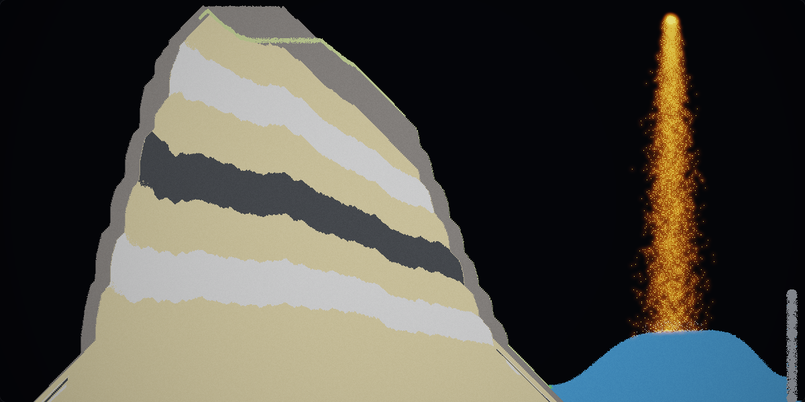
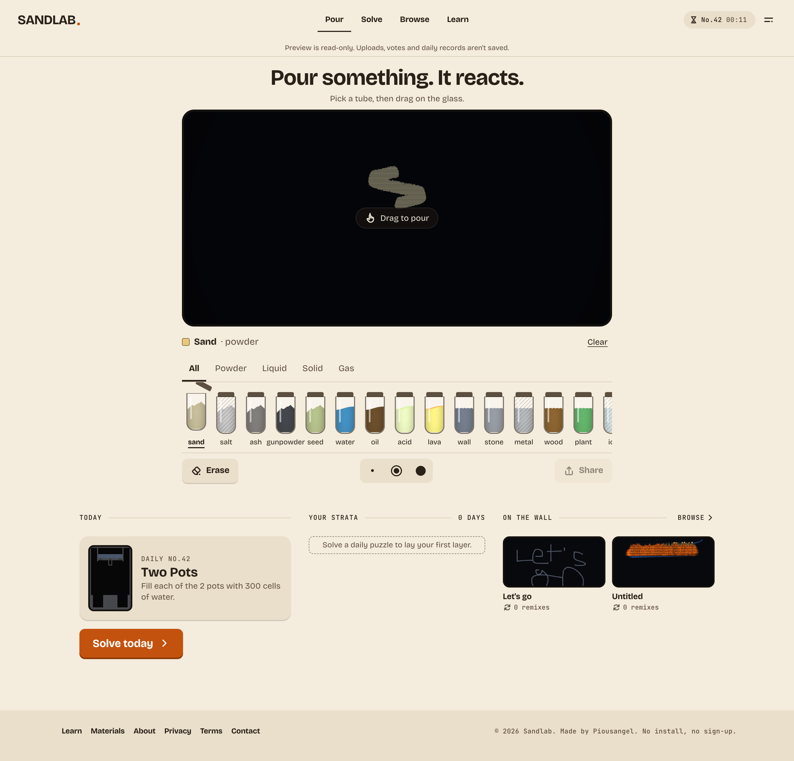

# Sandlab

> A WebGPU falling-sand sandbox and daily physics puzzle, built and run by a team of Claude Code agents working in shifts.

브라우저에서 바로 여는 WebGPU 낙사(falling-sand) 시뮬레이터와, 그 위에서 푸는 물리 퍼즐 **Spill**입니다. 설치·가입 없이 링크 하나로 열립니다.
**Claude Code를 실무에서 잘 쓰는 법을 익히려고 시작한 사이드 프로젝트**이기도 합니다. 기획·구현·리뷰·QA는 역할별 AI 에이전트가 2026-11-19부터 하루 7교대로 나눠 맡고, 배포는 머지 뒤 GitHub Actions가 합니다. 사람(오너)은 주로 방향을 잡고 되돌릴 수 없는 결정을 승인합니다.

- **무엇** — WebGPU 모래 놀이터 + 매일 같은 레벨을 푸는 물리 퍼즐 Spill + 장면 갤러리·리믹스
- **어떻게** — 역할을 나눈 Claude Code 에이전트가 교대로 리서치→기획→반증→독립 리뷰→출시를 돌리고, 사람은 규칙과 검사를 설계
- **증거** — 아래 [결정적 검사 표](#결정적-검사--규칙-문장보다-검사), [DECISIONS.md](DECISIONS.md). 2026-07-16 시작, 커밋 390개 중 283개에 Claude Code 공동 작성 표기(2026-11-20 기준)

**라이브:** https://sandlab.app



<sub>실제 엔진으로 렌더한 1200×600 격자 캡처.</sub>

## 목차

- [무엇이 있나](#무엇이-있나)
- [어떻게 만들고 운영하나 — AI 에이전트 팀](#어떻게-만들고-운영하나--ai-에이전트-팀)
- [기술 구성](#기술-구성)
- [SEO·GEO에서 한 일](#seogeo에서-한-일)
- [개발 시작하기](#개발-시작하기)
- [배포 — Cloudflare Workers 전용](#배포--cloudflare-workers-전용)
- [문서 지도](#문서-지도)
- [라이선스·크레딧](#라이선스크레딧)

## 무엇이 있나

- **WebGPU 샌드박스** — 1200×600 격자(약 72만 칸)에 재료 18종(모래·물·기름·용암·산·화약·씨앗·얼음·불 등)을 붓고 반응을 봅니다. 장면을 짧은 영상(mp4)으로 녹화할 수 있습니다.
- **Spill 물리 퍼즐** — "두 화분에 물을 300칸씩 채워라" 같은 목표를 물리로 푸는 퍼즐. 레벨 11개(월드 1 10개 + 월드 2 1개)이고 레벨마다 공략 페이지가 있습니다. 데일리(`/daily`)는 월드 1 레벨 9개를 UTC 날짜로 돌려, 전 세계가 같은 날 같은 레벨을 풉니다.
- **갤러리** — 만든 장면을 올리고 Hot(7일 창)·New·투표로 둘러봅니다. 댓글은 없습니다(독성을 막으려는 결정이지 누락이 아닙니다).
- **리믹스** — 다른 사람 장면을 열어 고쳐 다시 올리면 원본과 계보(parent)로 이어지고, 원본 카드에 리믹스 수가 붙습니다.
- **Learn** — 시뮬레이션 원리 글 3편(Margolus 이웃, 재료를 데이터로, 낙사 게임의 역사)과 재료별 페이지(`/materials`).

**디자인 개편 진행 중** — 새 화면들은 운영 화면에 영향 없이 main에 쌓고 있습니다. 기본 빌드에서는 꺼져 있고(`pnpm build:preview`로 켬), 공개 전환은 마지막 컷오버 PR에서 합니다. 진행표: [docs/plans/2026-11-19-redesign-v2.md](docs/plans/2026-11-19-redesign-v2.md) 6장.

<details>
<summary>개편 중인 새 홈 캡처 (로컬 빌드, 아직 비공개)</summary>



</details>

## 어떻게 만들고 운영하나 — AI 에이전트 팀

커밋 대부분은 Claude Code 세션(정해진 시각에 도는 클라우드 루틴 포함)이 씁니다. 자매 프로젝트 [Quick MiniGames](https://github.com/Piousangel/minigames-hub)와 같은 운영 체계를 씁니다.

### 교대 구조

24시간 교대 규칙은 허브 저장소의 [ROTA.md](https://github.com/Piousangel/minigames-hub/blob/main/docs/team/ROTA.md)에 함께 있고, 개편 기간의 개발 교대 배정은 [계획서 5장](docs/plans/2026-11-19-redesign-v2.md)을 따릅니다. 샌드랩은 하루 7교대(KST):

| 시각 | 교대 |
|---|---|
| 03 | 야간 QA·품질 |
| 06 | 회의 → 반영 → 오너 보고 메일 |
| 10 · 16 | 개발(리디자인 v2 PR을 계획서 순서대로 이어받음) |
| 13 | 설계 숙의·개발 |
| 20 | 마무리·출시 확인·홍보 초안·하루 요약 |
| 23 | 야간 개발 |

교대 규칙: 시작할 때 [NORTH-STAR.md](docs/team/NORTH-STAR.md)(90일 미션·지표)를 보고 열린 PR·브랜치를 확인해 같은 일을 겹쳐 하지 않고, 끝낼 때 인계서([.claude/handoff/main.md](.claude/handoff/main.md))에 한 일·막힌 것·다음 교대 몫을 남깁니다. main 직접 푸시·force push·테스트 약화는 금지입니다.

### 한 출시가 거치는 절차

리서치(서로 다른 출처 3종 이상) → 기획 v1 → **반증 리서치** → 기획 v2 → **독립 리뷰**(작성자가 아닌 에이전트가 혹평, 지적마다 수용·거부 응답) → 구현 → 모바일·데스크톱 캡처와 수치 → 리뷰 → squash 머지 → Actions 배포. 절차는 [SESSION-GUIDE.md](docs/team/SESSION-GUIDE.md), 결정과 버린 안은 [DECISIONS.md](DECISIONS.md)에 남깁니다.

큰 개편은 PR마다 **운영 빌드 HTML이 바뀌지 않았는지** 비교해, 공개 전까지 사용자 화면에 영향을 주지 않게 합니다. 일부러 운영에 들어가는 변경(예: 데일리 공유 텍스트)은 진행표에 따로 적습니다.

### 결정적 검사 — 규칙 문장보다 검사

| 검사 | 무엇을 떨어뜨리나 | 어디서 도나 |
|---|---|---|
| `node scripts/verify-ads.mjs` | 광고 로더가 캔버스·로딩 화면에 실리거나, 광고 페이지 본문이 최소 분량보다 적은 빌드. AdSense 반려(2026-09-21) 뒤 만든 검사 | CI(배포 명령) |
| `src/lib/sand/shareLinks.golden.test.ts` | 공유 링크(`#s=`·`#g=`·`/s/:id`)와 리믹스 계보가 바뀌어 기존 링크가 깨지는 것 | CI(Vitest) |
| `src/app/sitemap.test.ts` | 사이트맵에서 레벨·공략·Learn 페이지가 빠지거나, 301로 옮긴 옛 URL이 남는 것 | CI(Vitest) |
| `pnpm spill:verify` | Spill 레벨이 풀리지 않거나, 가만히 둬도 풀리거나, 시드·타이밍이 조금만 달라도 결과가 뒤집히는 것(레벨마다 검사 13종) | 머지 전 교대(로컬 약 3분, CI에선 22분이라 제외) |
| `pnpm check:contrast` | 디자인 토큰 색 쌍이 WCAG 대비(본문 4.5:1, 큰 글자·윤곽 3:1)를 못 넘는 것 | 개편 PR에서 수동·프리뷰 워크플로 |
| `pnpm lint:ui` | 새 UI에 이모지·유니코드 기호를 아이콘으로 쓰거나, 회색 면 위에 회색 면을 쌓는 것 | 개편 PR에서 수동·프리뷰 워크플로 |
| `node scripts/verify-margolus.mjs` | Margolus 규칙의 CPU 레퍼런스 포트가 질량을 잃거나, 밀도 순서가 틀리거나, 좌우로 치우치는 것(GPU 셰이더 자체는 브라우저에서 확인) | 시뮬 변경 시 수동 |

### 참고 강연에서 가져온 원칙 (팀 안에서는 '스승님 원칙')

Lauren Tan·Lydia Hallie의 강연에서 가져온 원칙(교정은 검사로, 오답을 떨어뜨리는 검사를 PR 첫 줄에, 되돌릴 수 없는 변경은 `고위험` 표시와 리뷰 2회)을 [SESSION-GUIDE.md](docs/team/SESSION-GUIDE.md) 맨 위에 두었습니다. 위 표의 `verify-ads`·`check:contrast`·`lint:ui`가 그 본보기입니다. 원문 정리는 허브의 [docs/team/mentor/](https://github.com/Piousangel/minigames-hub/blob/main/docs/team/mentor/README.md).

### 자격증명은 에이전트 밖에

에이전트 샌드박스에는 계정 자격증명이 없습니다. 에이전트는 PR만 올리고, main 머지 후 GitHub Actions가 시크릿으로 배포(`deploy.yml`), 그림 생성(`gen-assets.yml`), 지표 수집(`metrics.yml` → `docs/daily/metrics/`)을 합니다. SNS 게시 파이프라인(`marketing-post.yml`)도 있지만 지금 샌드랩 규칙상 에이전트는 문안 초안까지만 쓰고 게시는 사람이 합니다.

Claude Code 설정도 저장소에 있습니다: 데일리 세션 스킬 [.claude/skills/sandlab-daily/SKILL.md](.claude/skills/sandlab-daily/SKILL.md), 역할 헌장과 조사 자료 [.claude/team/](.claude/team/charter.md).

## 기술 구성

| 영역 | 사용 |
|---|---|
| 프론트 | Next.js 15 정적 export, React 19, TypeScript |
| 시뮬레이션 | WebGPU 컴퓨트 셰이더(`src/lib/sand/shader.ts`), Spill은 결정적 CPU 시뮬(160×240) |
| 호스팅 | Cloudflare Workers 정적 에셋 + 커스텀 도메인 sandlab.app. 개편 화면용 프리뷰 Worker 설정(읽기 전용)도 있음 |
| API | 같은 Worker(`worker/`): 갤러리 업로드·목록·투표, 데일리, Spill 기록, 계측 |
| 데이터 | Cloudflare D1(`sandlab-gallery`), Analytics Engine(`sandlab_events`) |
| 영상 | `canvas.captureStream()` + MediaRecorder, mediabunny로 표준 mp4 리먹스(`src/lib/sand/record.ts`) |
| 테스트 | Vitest, 검사 스크립트(`scripts/verify-*`, `spill:verify`, `check:contrast`, `lint:ui`) |
| 이미지 | `scripts/gen-assets.py` — Gemini 이미지 모델. 요청을 PR로 올리면 Actions가 생성·커밋, 장부 `docs/design/asset-ledger.json` |

### 아키텍처 메모

- **Margolus 이웃** — 2×2 블록을 한 스레드가 맡고 블록 원점을 매 틱 번갈아 바꿉니다. 두 셀이 같은 빈칸을 다투다 질량이 복제·소멸하는 경쟁이 구조적으로 생기지 않아, 이동 단계에 락·원자 연산이 필요 없습니다.
- **재료는 코드가 아니라 표** — `materials.ts`의 `{color, density, movement, lifetime, emissive, reactions[]}`를 셰이더가 조회만 합니다. 로컬 LLM이 자연어로 표를 채우게 하려는 설계이고, 스키마만 사전 검증했습니다(기능은 미구현).
- **블룸** — 화면 픽셀이 아니라 격자 해상도에서 분리형 가우시안을 돌려, 캔버스가 커져도 비용이 늘지 않습니다.
- **공유** — RLE + deflate + base64url을 URL 해시(`#g=`)에 담아 서버 없이 공유합니다. 무거운 장면은 URL 예산(6,000자)을 넘기 때문에 갤러리 id(`#s=`)가 있습니다. 측정: `node scripts/verify-url.mjs`.

## SEO·GEO에서 한 일

- **정적 HTML** — 홈·Learn·재료·레벨·공략 페이지를 빌드 때 HTML로 굽고, `sitemap.ts`·`robots.ts`도 정적 생성합니다.
- **사이트맵 테스트** — 모든 Spill 레벨과 레벨별 공략, Learn 글이 사이트맵에 있고 301로 옮긴 옛 레벨 URL은 없는지 `sitemap.test.ts`가 지킵니다.
- **구조화 데이터(JSON-LD)** — `VideoGame`(`src/lib/gameJsonLd.ts`), Learn 글 `Article`, `BreadcrumbList`.
- **광고 페이지 본문 하한** — 광고가 붙는 페이지는 정적 본문이 최소 분량 이상이어야 배포됩니다(`verify-ads.mjs`).
- **중복 색인 방지** — 개편 화면용 프리뷰 빌드는 robots 전체 차단 + `X-Robots-Tag: noindex`로 설정해 두었습니다.
- **설명하는 글(GEO 의도)** — 생성형 AI 검색이 출처로 쓰기 좋게 원리를 직접 설명하는 글(Margolus 알고리즘, 재료를 데이터로 다루는 법, 장르의 역사)과 재료별 페이지를 두었습니다. 노출 성과는 아직 측정하지 않았습니다.

## 개발 시작하기

요구: Node 22, pnpm.

```bash
pnpm install
pnpm build                                  # 정적 에셋 out/ 생성 (wrangler dev가 이걸 서빙)
npx wrangler d1 execute sandlab-gallery --local --file=schema.sql   # 로컬 D1 처음 한 번
npx wrangler dev --port 8799 --local        # http://localhost:8799 — 화면 + API. 이걸 쓴다
```

개편 중인 새 화면을 보려면 `pnpm build` 대신 `pnpm build:preview`. `pnpm dev`(포트 3120)는 시뮬 화면만 뜨고 API가 없습니다. API는 Worker이고 Worker는 wrangler에서만 돌기 때문에, `pnpm dev`만 쓰면 Publish·갤러리가 404로 고장 난 것처럼 보입니다.

검증:

```bash
pnpm typecheck
pnpm test --exclude src/lib/spill/verify/verify.test.ts   # Vitest (verify.test.ts는 알려진 타임아웃 실패라 CI와 같이 제외)
pnpm lint:ui && pnpm check:contrast
pnpm spill:verify                      # Spill 레벨 검사 (로컬 약 3분)
node scripts/verify-margolus.mjs       # 시뮬 불변식(CPU 레퍼런스)
node scripts/verify-url.mjs            # URL 예산 측정 (무거운 장면 때문에 의도적으로 exit 1)
python3 scripts/verify-gallery.py      # 갤러리 API (wrangler dev 필요)
python3 scripts/verify-daily.py        # 데일리 API (wrangler dev 필요)
```

## 배포 — Cloudflare Workers 전용

```bash
pnpm run deploy    # next build → scripts/verify-ads.mjs → wrangler deploy
```

> `pnpm deploy`(`run` 없이)는 실패합니다 — pnpm 내장 workspace 명령과 충돌합니다. 평소에는 main 머지 시 GitHub Actions가 배포합니다.

**Vercel에서는 동작하지 않습니다.** 정적 시뮬은 뜨지만 갤러리 호출이 모두 404입니다.

| | Vercel | Cloudflare |
|---|---|---|
| `/` (sim) | 200 | 200 |
| `/gallery` | 200 (껍데기만) | 200 |
| `/api/scenes` | **404** | 200 |

이유는 두 가지입니다. ① `worker/index.ts`는 Cloudflare Worker라 Vercel이 모릅니다. ② 갤러리 데이터는 Cloudflare 전용인 **D1**에 있습니다. Vercel로 옮기려면 API를 Route Handler로 다시 쓰고 D1을 다른 DB로 바꿔 두 벌을 맞춰야 합니다. 반쯤 동작하는 배포(Publish를 누르면 404)는 없는 것보다 나쁩니다.

그 밖의 절대 규칙(격자 크기 1200×600 고정 — 공유 URL이 w,h를 담음, 댓글 기능 금지)은 [CLAUDE.md](CLAUDE.md).

## 문서 지도

| 문서 | 내용 |
|---|---|
| [CLAUDE.md](CLAUDE.md) | 에이전트가 먼저 읽는 절대 규칙·검증 명령 |
| [.claude/handoff/main.md](.claude/handoff/main.md) | 인계서 — 다음 할 일, 멈춘 지점, 함정 |
| [DECISIONS.md](DECISIONS.md) | 결정 기록(맥락·선택·버린 안·근거) |
| [docs/team/NORTH-STAR.md](docs/team/NORTH-STAR.md) | 북극성 — 90일 미션·지표·단계. 교대마다 시작할 때 보고, 끝날 때 지표 한 줄을 남김 |
| [docs/team/SESSION-GUIDE.md](docs/team/SESSION-GUIDE.md) | 세션 절차, 참고 강연 원칙 |
| [docs/team/OPERATING.md](docs/team/OPERATING.md) | 팀 운영 규칙(첫 화면, 마케터, 주간 회고) |
| [docs/team/DESIGN-PROCESS.md](docs/team/DESIGN-PROCESS.md) · [GEMINI.md](docs/team/GEMINI.md) | 설계 관문, Gemini 시안·혹평 절차 |
| [docs/plans/2026-11-19-redesign-v2.md](docs/plans/2026-11-19-redesign-v2.md) | 리디자인 v2 계획과 PR 진행표 |
| [docs/ops/playbook.md](docs/ops/playbook.md) | 팀 운영 플레이북(사이트마다 한 팀, 새 팀 세우는 순서) |
| [docs/daily/](docs/daily/) | 일일 지표(`metrics/`)·로그·백로그 |

## 라이선스·크레딧

- 폰트: Bricolage Grotesque, JetBrains Mono — SIL Open Font License 1.1([src/ui-next/fonts/OFL.txt](src/ui-next/fonts/OFL.txt)).
- 갤러리 Hot 정렬은 The Powder Toy 프런트 페이지 방식(7일 창)을 참고했고, 댓글을 두지 않는 결정은 Sandspiel 제작자의 선택을 참고했습니다.
- 소스 코드에는 별도 오픈소스 라이선스를 붙이지 않았습니다.
